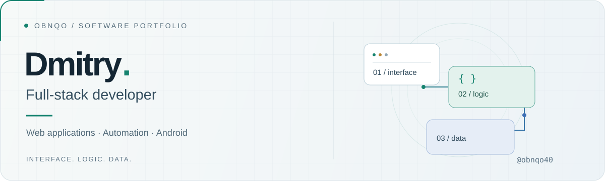
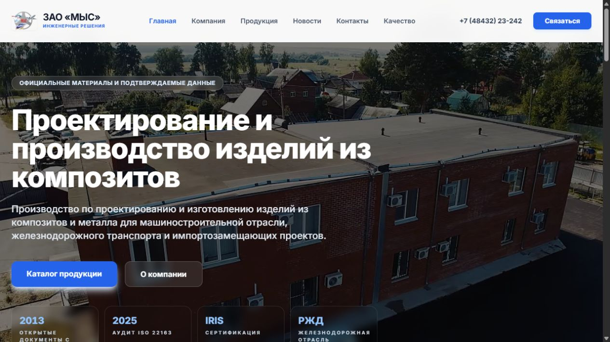
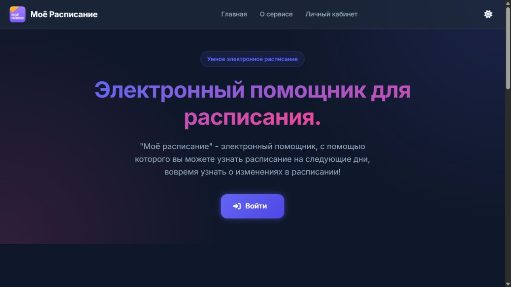

<picture>
  <source media="(prefers-color-scheme: dark)" srcset="https://raw.githubusercontent.com/obnqo40/obnqo40/main/assets/hero-dark.svg">
  
</picture>

# Hi, I'm Dmitry

**Full-stack / Backend Developer** working on web applications, Python automation, and Android.

I turn everyday workflows into applications: service bookings, school schedules, warehouse picking, and community tools. My projects connect interfaces, data, and external APIs, with attention to failure handling and useful documentation.

[Русская версия](README.md) · [Project catalog](docs/projects.md) · [Code tour (RU)](docs/code-tour.md)

## Explore live demos

**[Business Leads ↗](https://business-leads-template.vercel.app/)** · **[ZAO MYS ↗](https://obnqo40.github.io/zao_mys/)** · **[Moe Raspisanie ↗](https://moe-raspisanie.vercel.app/)**

[All verified addresses and alternate hosting (RU)](docs/demos.md)

## Selected public projects

<table>
  <tr>
    <td width="50%" valign="top">
      <h3>01 / Business Leads</h3>
      
      
Configurable service-business website with server-side validation and independent delivery adapters for Telegram, MAX, email, and Google Sheets.

      
<code>Next.js</code> <code>React</code> <code>TypeScript</code>

      
<strong><a href="https://business-leads-template.vercel.app/">Live demo ↗</a></strong> · <a href="https://github.com/obnqo40/business-leads-template">Source</a> · <a href="docs/business-leads.md">Case study (RU)</a>

    </td>
    <td width="50%" valign="top">
      <h3>02 / ZAO MYS</h3>
      
      
Multi-page industrial website frontend with a product catalog, image galleries, company information, quality documents, and shared interactions.

      
<code>HTML / CSS</code> <code>JavaScript</code> <code>Alpine.js</code>

      
<strong><a href="https://obnqo40.github.io/zao_mys/">Live demo ↗</a></strong> · <a href="https://github.com/obnqo40/zao_mys">Source</a> · <a href="docs/zao-mys.md">Case study (RU)</a>

    </td>
  </tr>
  <tr>
    <td width="50%" valign="top">
      <h3>03 / Moe Raspisanie</h3>
      
      
School schedules, conflict checks, Excel import/export, IndexedDB, and a PWA shell. Educational V1; server authentication is planned for V2.

      
<code>JavaScript</code> <code>IndexedDB</code> <code>PWA</code>

      
<strong><a href="https://moe-raspisanie.vercel.app/">Live demo ↗</a></strong> · <a href="https://obnqo40.github.io/Moe-raspisanie/">GitHub Pages</a> · <a href="https://github.com/obnqo40/Moe-raspisanie">Source</a>

    </td>
    <td width="50%" valign="top">
      <h3>04 / Full-stack Lab</h3>
      
      
Nginx load balancing across two static-page containers and a separate PostgreSQL service. A local Docker Compose learning environment.

      
<code>Docker Compose</code> <code>Nginx</code> <code>PostgreSQL</code>

      
<strong><a href="https://github.com/obnqo40/full-stack-lab#запуск">Local setup →</a></strong> · <a href="https://github.com/obnqo40/full-stack-lab">Source</a>

    </td>
  </tr>
</table>

## Local development case studies

These write-ups describe local implementations. Their source code is not published in this profile repository.

- **[Skladmen WMS](docs/skladmen.md)** — Kotlin, Jetpack Compose, Room, Hilt; warehouse orders, CSV import/export, barcode lookup, and picking progress.
- **[MAXGRAM](docs/maxgram.md)** — an independent fork of the open-source Telegram Android client; custom themes, navigation, and local tools. Upstream attribution is part of the case study.
- **[Vanta Market](docs/automation.md#vanta-market)** — asynchronous bots sharing SQLite stock; order and payment states, delivery reconciliation, and operational checks.
- **[SWAGA BOT](docs/automation.md#swaga-bot)** — Discord voice-room lifecycle, permission management, and restart recovery.
- **[VK Consent Monitor](docs/automation.md#vk-consent-monitor)** — an official-API status monitor restricted to an explicit list of consented profiles.

## Technology

`TypeScript` `React` `Next.js` `Python` `asyncio` `Kotlin` `Java` `Compose` `SQLite` `Docker Compose` `Nginx`

I value clear component boundaries, input validation, durable state, and documentation that distinguishes implemented behavior from future work.

---

Find the relevant [repository](https://github.com/obnqo40?tab=repositories) and open an issue to discuss a project.
