<picture>
  <source media="(prefers-color-scheme: dark)" srcset="https://raw.githubusercontent.com/obnqo40/obnqo40/main/assets/studio/hero-dark.svg">
  
</picture>

<strong>Dmitry · Full-stack / Backend Developer</strong> Web applications, Python tools, and Android prototypes built around real workflows.

  
  <a href="docs/code-tour.md">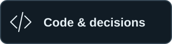</a>
  <a href="docs/projects.md">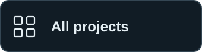</a>

<a href="README.md">Русская версия</a>

<strong>Open in your browser:</strong> <a href="https://business-leads-template.vercel.app/">Business Leads ↗</a> · <a href="https://obnqo40.github.io/zao_mys/">ZAO MYS ↗</a> · <a href="https://moe-raspisanie.vercel.app/">Moe Raspisanie ↗</a>

## Selected projects

Interfaces, logic, and data brought together around a specific task.

### 01 · Business Leads

<a href="https://business-leads-template.vercel.app/">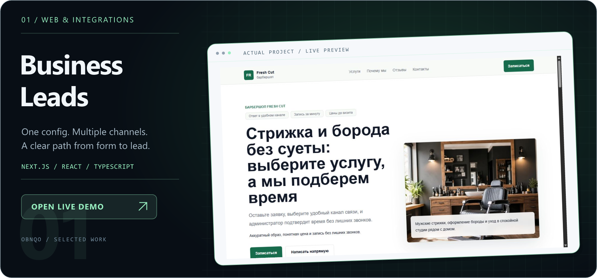</a>

One configuration defines the website content. The server validates leads and independently attempts delivery through Telegram, MAX, email, and Google Sheets. One failed channel does not stop the others.

`Next.js` `React` `TypeScript` `API Routes`

**[Live demo ↗](https://business-leads-template.vercel.app/)** &nbsp; · &nbsp; [Source](https://github.com/obnqo40/business-leads-template) &nbsp; · &nbsp; [Architecture (RU)](docs/business-leads.md)

### 02 · ZAO MYS

<a href="https://obnqo40.github.io/zao_mys/">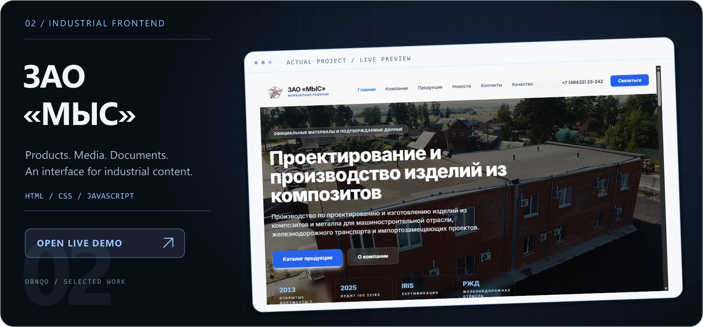</a>

Multi-page industrial website frontend with a product catalog, media galleries, and documents. Shared styling and browser interactions connect the company, quality, news, and contact pages.

`HTML / CSS` `JavaScript` `Alpine.js` `Tailwind CSS`

**[Live demo ↗](https://obnqo40.github.io/zao_mys/)** &nbsp; · &nbsp; [Source](https://github.com/obnqo40/zao_mys) &nbsp; · &nbsp; [Case study (RU)](docs/zao-mys.md)

### 03 · Moe Raspisanie

<a href="https://moe-raspisanie.vercel.app/">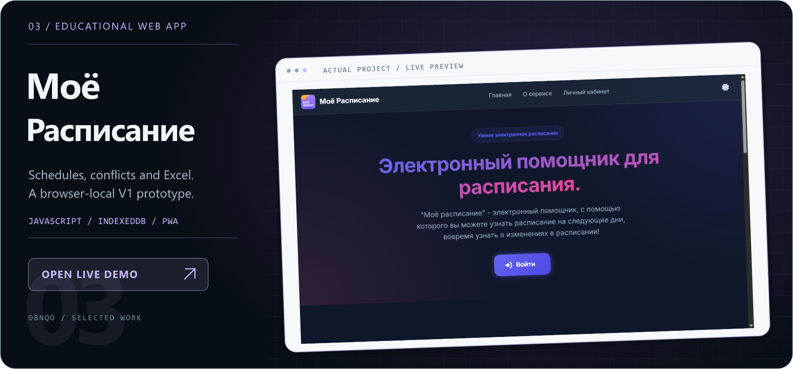</a>

Lesson editing, conflict checks, schedule generation, and Excel import/export. Educational V1 stores data in the browser; server authentication is planned for V2.

`JavaScript` `IndexedDB` `Excel` `PWA`

**[Live demo ↗](https://moe-raspisanie.vercel.app/)** &nbsp; · &nbsp; [GitHub Pages](https://obnqo40.github.io/Moe-raspisanie/) &nbsp; · &nbsp; [Source](https://github.com/obnqo40/Moe-raspisanie) &nbsp; · &nbsp; [Case study (RU)](docs/scheduling.md)

### 04 · Full-stack Lab

<a href="https://github.com/obnqo40/full-stack-lab#readme">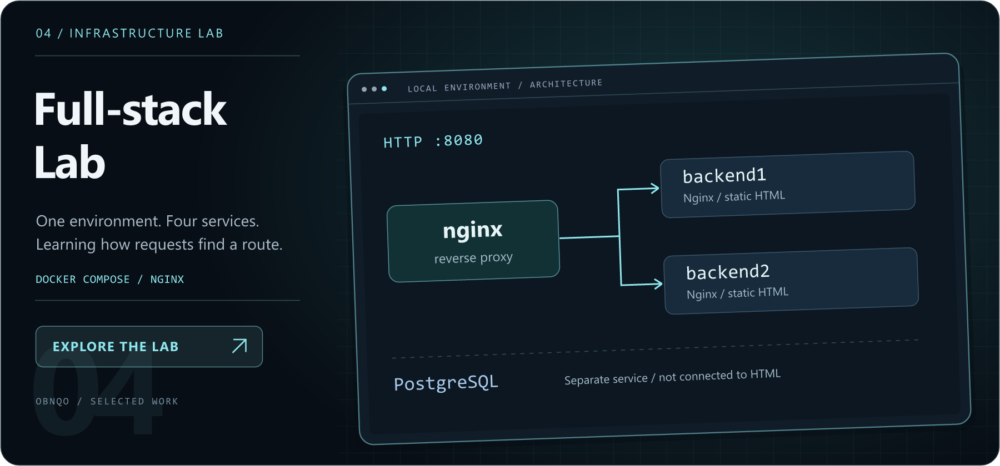</a>

A local Docker Compose lab. Nginx routes requests to two static-page containers, while PostgreSQL runs as a separate service for experiments.

`Docker Compose` `Nginx` `PostgreSQL`

**[Local setup →](https://github.com/obnqo40/full-stack-lab#запуск)** &nbsp; · &nbsp; [Source](https://github.com/obnqo40/full-stack-lab) &nbsp; · &nbsp; [Code tour (RU)](docs/code-tour.md#4-как-запрос-попадает-в-один-из-контейнеров)

## Beyond the web

Local Android and Python developments complement the public web projects. Their case studies describe the implementation and its limits; their source code is not published in this profile repository.

  <a href="docs/skladmen.md">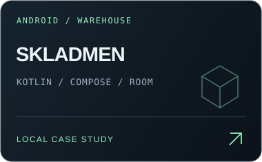</a>
  <a href="docs/maxgram.md">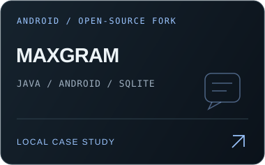</a>
  <a href="docs/automation.md">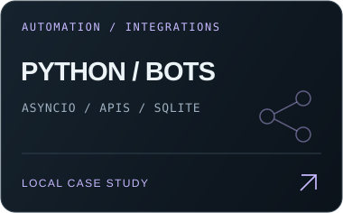</a>

<strong>Inside the local projects</strong>

- **[Skladmen WMS](docs/skladmen.md)** — Kotlin, Compose, and Room; warehouse orders, CSV, barcode lookup, and picking progress.
- **[MAXGRAM](docs/maxgram.md)** — customization of the open-source Telegram Android client, with upstream attribution.
- **[Vanta Market](docs/automation.md#vanta-market)** — asynchronous bots, shared SQLite stock, order states, and delivery reconciliation.
- **[SWAGA BOT](docs/automation.md#swaga-bot)** — Discord voice-room lifecycle, permissions, and restart recovery.
- **[VK Consent Monitor](docs/automation.md#vk-consent-monitor)** — official API, an explicit allowed-profile list, and state transitions.

## Tools in my projects

**Web and APIs** &nbsp; TypeScript · React · Next.js · HTML · CSS 
**Automation** &nbsp; Python · asyncio · aiohttp · aiogram · discord.py 
**Android** &nbsp; Kotlin · Java · Compose · Room · Hilt · Coroutines 
**Data and environment** &nbsp; SQLite · IndexedDB · PostgreSQL · Docker Compose · Nginx

I value clear component boundaries, input validation, and durable state. Plans and local prototypes are distinguished from published code. [Explore the engineering decisions (RU) →](docs/code-tour.md)

 

<a href="https://github.com/obnqo40?tab=repositories">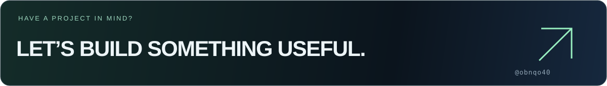</a>

<a href="docs/projects.md">Project catalog</a> &nbsp; / &nbsp; <a href="docs/demos.md">All demos</a> &nbsp; / &nbsp; <a href="docs/code-tour.md">Code tour</a> &nbsp; / &nbsp; <a href="README.md">Русская версия</a>

