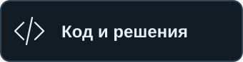
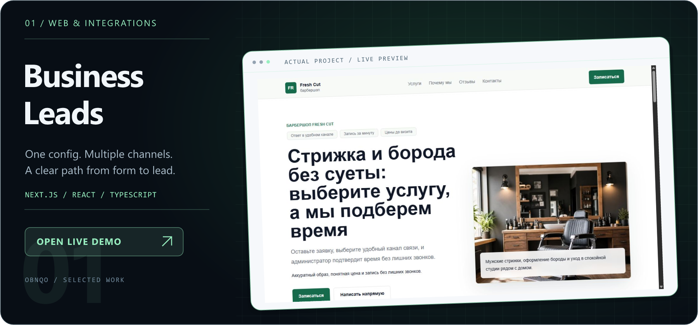
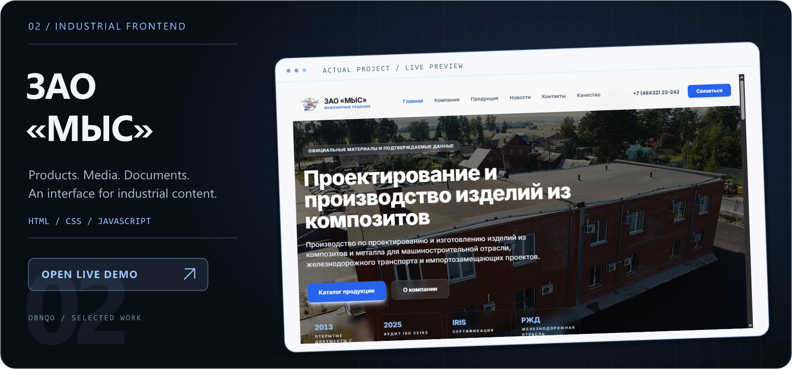
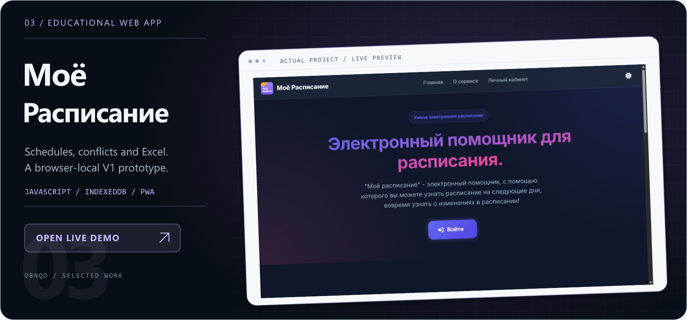
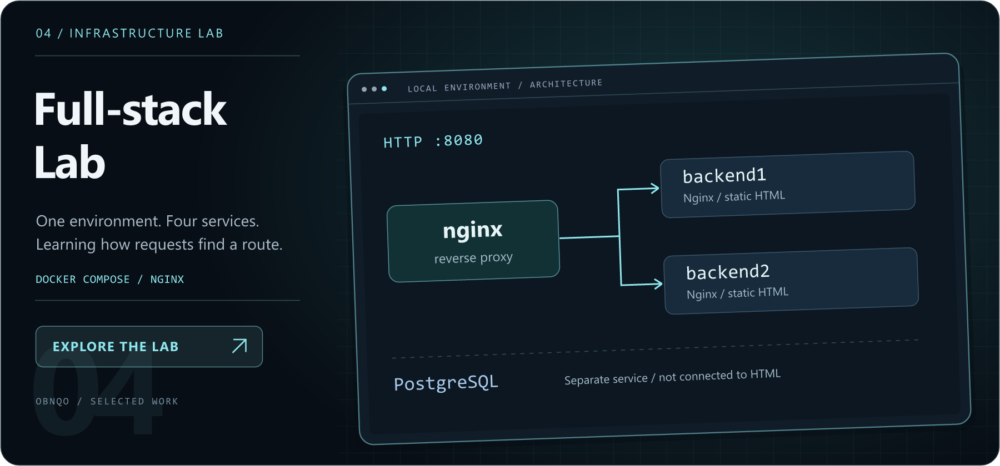
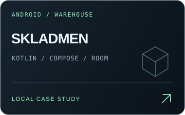
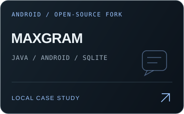
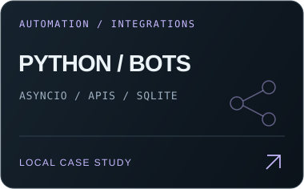

<picture>
  <source media="(prefers-color-scheme: dark)" srcset="https://raw.githubusercontent.com/obnqo40/obnqo40/main/assets/studio/hero-dark.svg">
  
</picture>

<strong>Дмитрий · Full-stack / Backend Developer</strong> Создаю веб-приложения, Python-инструменты и Android-прототипы для реальных задач.

  
  
  

<a href="README.en.md">Read in English</a>

<strong>Открыть в браузере:</strong> <a href="https://business-leads-template.vercel.app/">Business Leads ↗</a> · <a href="https://obnqo40.github.io/zao_mys/">ЗАО «МЫС» ↗</a> · <a href="https://moe-raspisanie.vercel.app/">Моё Расписание ↗</a>

## Избранные проекты

Интерфейс, логика и данные — в каждом проекте эти части складываются вокруг конкретного сценария.

### 01 · Business Leads

Один конфиг задаёт контент сайта услуг, а сервер проверяет заявки и независимо передаёт их в Telegram, MAX, email и Google Sheets. Отказ одного канала не прерывает попытки в остальных.

`Next.js` `React` `TypeScript` `API Routes`

**[Открыть демо ↗](https://business-leads-template.vercel.app/)** &nbsp; · &nbsp; [Исходный код](https://github.com/obnqo40/business-leads-template) &nbsp; · &nbsp; [Архитектура и решения](docs/business-leads.md)

### 02 · ЗАО «МЫС»

Многостраничный промышленный сайт с каталогом продукции, галереями и документами. Общие стили и браузерные сценарии связывают страницы компании, качества, новостей и контактов.

`HTML / CSS` `JavaScript` `Alpine.js` `Tailwind CSS`

**[Открыть демо ↗](https://obnqo40.github.io/zao_mys/)** &nbsp; · &nbsp; [Исходный код](https://github.com/obnqo40/zao_mys) &nbsp; · &nbsp; [Разбор проекта](docs/zao-mys.md)

### 03 · Моё Расписание

Редактирование уроков, проверка пересечений, генерация расписания и обмен с Excel. Учебная V1 хранит данные в браузере; серверная авторизация относится к планируемой V2.

`JavaScript` `IndexedDB` `Excel` `PWA`

**[Открыть демо ↗](https://moe-raspisanie.vercel.app/)** &nbsp; · &nbsp; [GitHub Pages](https://obnqo40.github.io/Moe-raspisanie/) &nbsp; · &nbsp; [Исходный код](https://github.com/obnqo40/Moe-raspisanie) &nbsp; · &nbsp; [Разбор V1](docs/scheduling.md)

### 04 · Full-stack Lab

Локальная лаборатория Docker Compose: Nginx распределяет запросы между двумя контейнерами со статическими страницами. PostgreSQL запущен отдельным сервисом для экспериментов.

`Docker Compose` `Nginx` `PostgreSQL`

**[Запуск локально →](https://github.com/obnqo40/full-stack-lab#запуск)** &nbsp; · &nbsp; [Исходный код](https://github.com/obnqo40/full-stack-lab) &nbsp; · &nbsp; [Маршрут по коду](docs/code-tour.md#4-как-запрос-попадает-в-один-из-контейнеров)

## За пределами веба

Android и Python-разработки, которые дополняют публичные веб-проекты. Здесь опубликованы разборы локальных реализаций и их ограничений.

  
  
  

<strong>Что внутри этих разработок</strong>

- **[Skladmen WMS](docs/skladmen.md)** — комплектация складских заказов: Room, CSV, поиск по штрихкоду, архив и прогресс сборки.
- **[MAXGRAM](docs/maxgram.md)** — кастомизация открытого Telegram Android: темы, навигация и локальные инструменты с атрибуцией upstream.
- **[Vanta Market](docs/automation.md#vanta-market)** — асинхронные боты, общий остаток в SQLite, состояния заказа и сверка доставки.
- **[SWAGA BOT](docs/automation.md#swaga-bot)** — жизненный цикл голосовых комнат Discord, права доступа и восстановление после перезапуска.
- **[VK Consent Monitor](docs/automation.md#vk-consent-monitor)** — официальный API, список разрешённых профилей и обработка переходов состояния.

## Инструменты в моих проектах

**Веб и API** &nbsp; TypeScript · React · Next.js · HTML · CSS 
**Автоматизация** &nbsp; Python · asyncio · aiohttp · aiogram · discord.py 
**Android** &nbsp; Kotlin · Java · Compose · Room · Hilt · Coroutines 
**Данные и окружение** &nbsp; SQLite · IndexedDB · PostgreSQL · Docker Compose · Nginx

Для меня важны понятные границы компонентов, проверка входных данных и сохранность состояния. Планы и локальные прототипы отмечены отдельно от опубликованного кода. [Посмотреть решения на конкретных примерах →](docs/code-tour.md)

 

<a href="docs/projects.md">Полный каталог</a> &nbsp; / &nbsp; <a href="docs/demos.md">Все демо</a> &nbsp; / &nbsp; <a href="docs/code-tour.md">Код и решения</a> &nbsp; / &nbsp; <a href="README.en.md">English</a>

