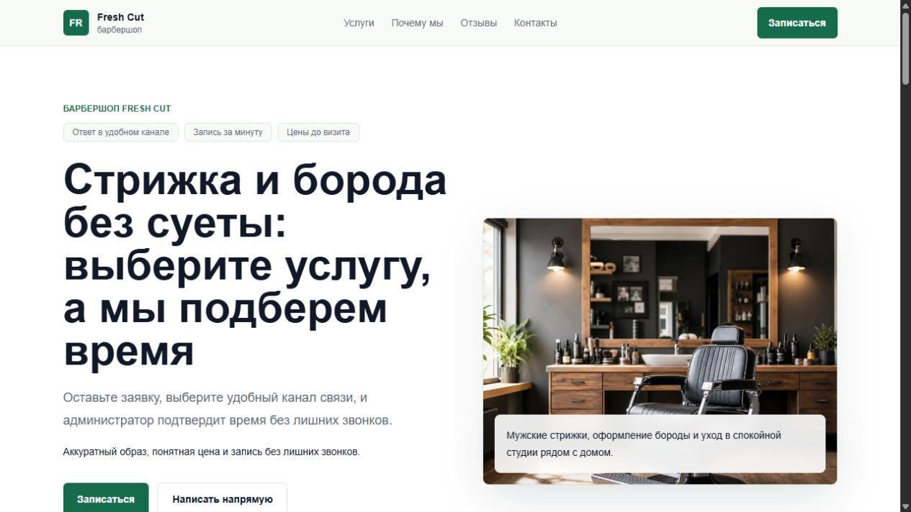
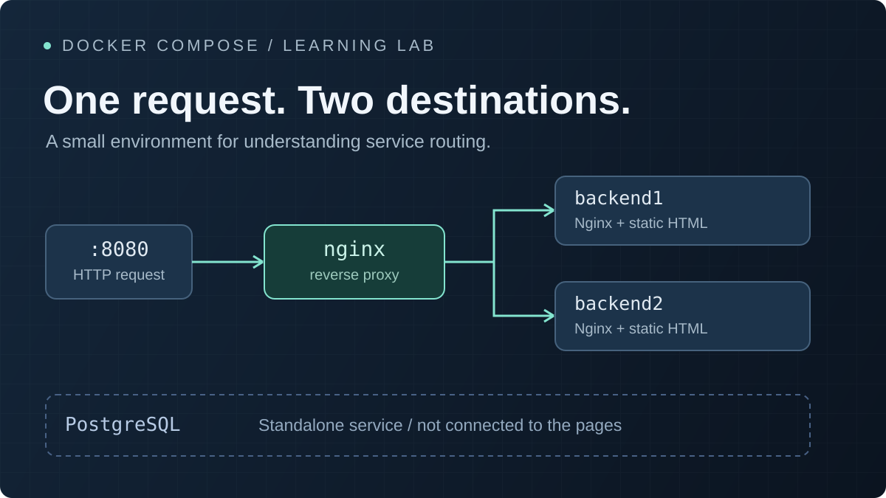

<picture>
  <source media="(prefers-color-scheme: dark)" srcset="https://raw.githubusercontent.com/obnqo40/obnqo40/main/assets/hero-dark.svg">
  
</picture>

# Привет, я Дмитрий

**Full-stack / Backend Developer** · веб-приложения, Python-автоматизация и Android.

Превращаю повседневные задачи в приложения: от записи на услугу и школьного расписания до складской комплектации и управления сообществом. В проектах работаю с интерфейсом, данными и интеграциями; отдельно уделяю внимание обработке ошибок и понятной документации.

**[Демо](#открыть-в-браузере)** &nbsp; / &nbsp; **[Проекты](#избранные-проекты)** &nbsp; / &nbsp; **[Разборы](#за-пределами-веба)** &nbsp; / &nbsp; **[Каталог](docs/projects.md)** &nbsp; / &nbsp; **[English](README.en.md)**

## Открыть в браузере

**[Business Leads ↗](https://business-leads-template.vercel.app/)** &nbsp; · &nbsp; **[ЗАО «МЫС» ↗](https://obnqo40.github.io/zao_mys/)** &nbsp; · &nbsp; **[Моё Расписание ↗](https://moe-raspisanie.vercel.app/)**

<a href="docs/demos.md">Все адреса и что посмотреть в каждом демо</a> · <a href="docs/code-tour.md">Маршрут по коду</a>

## Избранные проекты

<table>
  <tr>
    <td width="50%" valign="top">
      <h3>01 / Business Leads</h3>
      
      
<strong>От выбора услуги до заявки владельцу.</strong>

      
Сайт услуг с единым конфигом, серверной проверкой данных и независимой доставкой в Telegram, MAX, email и Google Sheets.

      
<code>Next.js</code> <code>React</code> <code>TypeScript</code>

      
<strong><a href="https://business-leads-template.vercel.app/">Демо ↗</a></strong> · <a href="https://github.com/obnqo40/business-leads-template">Код</a> · <a href="docs/business-leads.md">Разбор</a>

    </td>
    <td width="50%" valign="top">
      <h3>02 / ЗАО «МЫС»</h3>
      
      
<strong>Промышленный контент в понятном интерфейсе.</strong>

      
Многостраничный сайт: каталог продукции, галереи, страницы компании, качества, новостей и контактов.

      
<code>HTML / CSS</code> <code>JavaScript</code> <code>Alpine.js</code>

      
<strong><a href="https://obnqo40.github.io/zao_mys/">Демо ↗</a></strong> · <a href="https://github.com/obnqo40/zao_mys">Код</a> · <a href="docs/zao-mys.md">Разбор</a>

    </td>
  </tr>
  <tr>
    <td width="50%" valign="top">
      <h3>03 / Моё Расписание</h3>
      
      
<strong>Школьное расписание и работа с Excel.</strong>

      
Уроки, проверка пересечений, генерация и локальное хранение. Учебная V1 с PWA-оболочкой; серверная авторизация запланирована для V2.

      
<code>JavaScript</code> <code>IndexedDB</code> <code>PWA</code>

      
<strong><a href="https://moe-raspisanie.vercel.app/">Демо ↗</a></strong> · <a href="https://github.com/obnqo40/Moe-raspisanie">Код</a> · <a href="docs/scheduling.md">Разбор</a>

    </td>
    <td width="50%" valign="top">
      <h3>04 / Full-stack Lab</h3>
      
      
<strong>Несколько сервисов в одном окружении.</strong>

      
Nginx распределяет запросы между двумя контейнерами со статическими страницами. PostgreSQL — отдельный сервис учебного стенда.

      
<code>Docker Compose</code> <code>Nginx</code> <code>PostgreSQL</code>

      
<strong><a href="https://github.com/obnqo40/full-stack-lab#запуск">Запуск локально →</a></strong> · <a href="https://github.com/obnqo40/full-stack-lab">Код</a>

    </td>
  </tr>
</table>

**Любите разбираться в устройстве?** [Начните с API заявок, генератора расписания и общей логики страниц →](docs/code-tour.md)

## За пределами веба

Локальные разработки, для которых здесь опубликованы описания устройства и реализованных сценариев.

| Проект | Что в нём интересно | Разбор |
| :--- | :--- | :--- |
| **Skladmen WMS** | Android-приложение для комплектации заказов: Room, CSV, поиск по штрихкоду, архив | [Kotlin / Compose →](docs/skladmen.md) |
| **MAXGRAM** | Кастомизация открытого Telegram Android: темы, навигация, локальные инструменты | [Android fork →](docs/maxgram.md) |
| **Vanta Market** | Асинхронные боты, общий остаток в SQLite, состояния заказа и сверка доставки | [Python / SQLite →](docs/automation.md#vanta-market) |
| **SWAGA BOT** | Жизненный цикл голосовых комнат Discord, права доступа и восстановление после перезапуска | [Python / Discord →](docs/automation.md#swaga-bot) |
| **VK Consent Monitor** | Мониторинг разрешённых профилей через официальный API и обработка переходов состояния | [Python / API →](docs/automation.md#vk-consent-monitor) |

## Инструменты в моих проектах

| Направление | Технологии | Где посмотреть |
| :--- | :--- | :--- |
| Веб и API | TypeScript, React, Next.js, HTML, CSS | [Business Leads](https://github.com/obnqo40/business-leads-template) · [Моё Расписание](https://github.com/obnqo40/Moe-raspisanie) |
| Автоматизация | Python, asyncio, aiohttp, aiogram, discord.py | [Разбор ботов](docs/automation.md) |
| Android | Kotlin, Java, Compose, Room, Hilt, Coroutines | [Skladmen](docs/skladmen.md) · [MAXGRAM](docs/maxgram.md) |
| Данные и окружение | SQLite, IndexedDB, PostgreSQL, Docker Compose, Nginx | [Лаборатория](https://github.com/obnqo40/full-stack-lab) |

В разработке для меня важны понятные границы компонентов, проверка входных данных, сохранность состояния и честное описание ограничений. Планы и локальные прототипы в этом портфолио помечены отдельно от опубликованного кода.

---

**Хотите обсудить проект?** Начните с [репозитория](https://github.com/obnqo40?tab=repositories) и его Issues.

Ещё работы и учебные эксперименты — в <a href="docs/projects.md">полном каталоге</a>.
