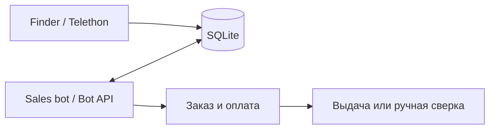

[← Профиль](https://github.com/obnqo40) · [Все проекты](projects.md)

# Python: боты и автоматизация

Три локальные разработки с разными задачами и общим вниманием к состоянию, ошибкам интеграций и восстановлению. Здесь опубликованы описания архитектуры; исходный код этих сервисов в профиль не загружен.

## Vanta Market

**Два асинхронных Telegram-бота с общим остатком в SQLite.**

Finder проверяет доступность коротких username через Telethon, sales-бот управляет заказами и выдачей найденных вариантов. Проверка доступности выполняется перед сохранением и выдачей; сама выдача варианта не резервирует имя в Telegram.

### Что показывает проект

- Транзакции SQLite и `BEGIN IMMEDIATE` для операций с остатком и заказами.
- Раздельные состояния платежа, доставки и возврата.
- Обработку неоднозначного результата сети: `delivery_uncertain` и `refund_uncertain` требуют сверки, прежде чем повторять внешнюю операцию.
- Ограничение частоты пользовательских действий и числа открытых заказов.
- Административную диагностику, ротацию журналов и проверки конфигурации.
- Локальные тесты с имитацией внешних взаимодействий.

**Граница гарантий:** Telegram `sendMessage` не предоставляет приложению ключ идемпотентности. Краш после удалённого успеха и до локальной записи требует сверки; проект не обещает exactly-once доставку. Статус локальной реализации не подтверждает текущую работу публичного сервиса или реальных платежей.

**Стек:** Python, asyncio, aiohttp, aiosqlite, Telethon, SQLite, pytest.

## SWAGA BOT

**Временные голосовые комнаты Discord с управлением доступом.**

Участник входит в канал создания, бот создаёт персональную комнату и перемещает его. Владелец управляет названием, лимитом, открытием комнаты и списками доступа через кнопки. Пустые комнаты удаляются, зарегистрированное состояние восстанавливается после перезапуска.

### Что показывает проект

- Обработку событий голосовых каналов и жизненного цикла ресурсов.
- Разделение владельца комнаты и обычных участников, работу с правами Discord.
- Хранение комнат и списков доступа в SQLite.
- Постоянные панели управления и очистку пустых комнат при запуске.
- Локальные сценарные тесты без токена Discord.

**Граница гарантий:** администраторы Discord могут обходить ограничения канала. Бот управляет только комнатами, зарегистрированными в своей базе. Текущее подключение к реальному серверу здесь не заявляется.

**Стек:** Python, discord.py, SQLite, unittest.

## VK Consent Monitor

**Telegram-бот для отслеживания переходов online/offline у разрешённых профилей.**

Профиль можно добавить только при наличии его ID в списке согласованных аккаунтов. Сервис обращается к официальному `users.get`, сохраняет историю в SQLite и уведомляет о переходе `OFFLINE → ONLINE`.

### Что показывает проект

- Явный список разрешённых профилей: пустая конфигурация запрещает добавление.
- State machine с отдельным состоянием `unknown` для недоступных данных.
- Запись состояния и события в одной транзакции.
- Отделение ошибки доставки уведомления от результата наблюдения.
- Пакетные запросы, повторные попытки и корректную остановку фонового poller.
- CLI-диагностику, Docker Compose и тесты с подставными API-клиентами.

**Граница гарантий:** `online` — поле ответа VK API, а не доказательство входа в аккаунт. Недоступные поля остаются неизвестными; проект не обходит ограничения приватности.

**Стек:** Python, aiogram, httpx, SQLAlchemy, aiosqlite, SQLite, pytest.
