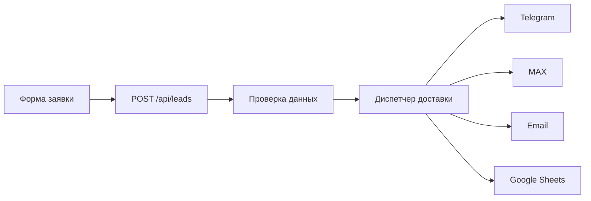

[← Профиль](https://github.com/obnqo40) · [Все проекты](projects.md)

# Business Leads

**Сайт услуг с серверным приёмом заявок и несколькими каналами доставки.**

[Демо ↗](https://business-leads-template.vercel.app/) · [Исходный код](https://github.com/obnqo40/business-leads-template)

## Задача

Подготовить основу для небольшого сайта услуг, которую можно адаптировать под новый бизнес через конфигурацию. Посетитель выбирает услугу и удобный способ связи, а владелец получает заявку в настроенные каналы.

## Решение

`business.config.ts` объединяет контент, услуги, контакты, тексты формы, настройки интеграций и тему. React-компоненты получают данные из этого конфига. Серверная часть отделена от представления.

## Инженерные решения

- **Повторное использование.** Для смены ниши контент и набор услуг меняются в конфиге.
- **Проверка на сервере.** Обрабатываются некорректный JSON, типы полей, допустимые услуги и способы связи, согласие и ограничения длины; размер тела ограничен 32 000 байтами.
- **Независимая доставка.** `Promise.allSettled` собирает результаты всех включённых адаптеров. Каждому отведено 10 секунд с сигналом отмены.
- **Понятный результат.** Успех означает доставку хотя бы в один канал. Отсутствие настроенных каналов и отказ всех каналов возвращают разные ошибки.
- **Разделение данных.** Публичный ответ содержит имена успешных и неуспешных каналов; детали ошибок проходят обработку на сервере.

## Что важно учитывать

Fresh Cut — демонстрационная конфигурация. Работу внешних каналов нужно проверять с настройками конкретного развёртывания. В текущей архитектуре нет постоянной очереди заявок, автоматической повторной доставки, CRM, авторизации или базы лидов. Honeypot помогает отсекать простые автоматические отправки; отдельного ограничения частоты запросов в коде нет.

**Стек:** Next.js App Router, React, TypeScript, Tailwind CSS, HTTP API.
