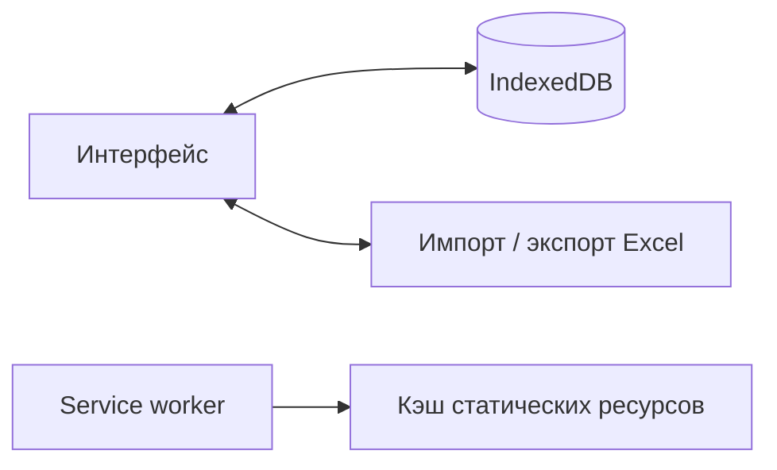

[← Профиль](https://github.com/obnqo40) · [Все проекты](projects.md)

# Моё Расписание

**Учебное веб-приложение для работы со школьным расписанием.**

[Демо ↗](https://moe-raspisanie.vercel.app/) · [Исходный код](https://github.com/obnqo40/Moe-raspisanie)

## Задача

Собрать в одном интерфейсе просмотр и редактирование уроков, справочник преподавателей, генерацию расписания и обмен данными с Excel.

## Что реализовано в V1

- Добавление, изменение и удаление уроков с проверкой пересечений.
- Автоматическая генерация расписания и интерфейсные сценарии для ученика и учителя.
- Импорт и экспорт таблиц `.xlsx`.
- Хранение расписания в IndexedDB и настроек в browser storage.
- Manifest и service worker для PWA-оболочки и кэширования статических ресурсов.

## Архитектурный вывод

Клиентское приложение удобно для изучения продукта и работы с локальными демонстрационными данными. Оно также показывает границу такого подхода: пользователь контролирует состояние браузера, поэтому интерфейсные роли и локальная проверка пароля не обеспечивают серверную авторизацию.

В публичной V1 удалённая запись пользователей и привилегированная синхронизация с GitHub отключены, набор пользователей пуст. Демонстрацию следует использовать с вымышленными данными.

## Следующий шаг

В README проекта описано направление V2: аутентифицированный backend API, серверные права доступа и PostgreSQL. Это план, который ещё не реализован в опубликованной V1.

**Стек:** JavaScript, HTML, CSS, IndexedDB, SheetJS/XLSX, PWA.
