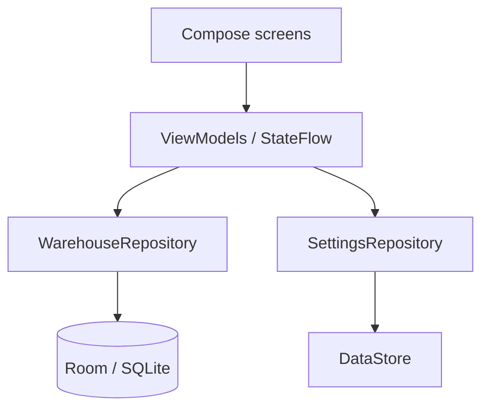

[← Профиль](https://github.com/obnqo40) · [Все проекты](projects.md)

# Skladmen WMS

**Android-прототип для складской комплектации заказов.**

**Статус:** локальная разработка; здесь опубликовано описание, исходный код и APK в этот репозиторий не входят.

## Задача

Помочь пользователю последовательно собрать заказ: найти позицию, отметить собранное количество, увидеть прогресс и сохранить результат между запусками приложения.

## Реализованные сценарии

- Создание заказов, проверка номера и защита от дубликатов.
- Добавление и изменение позиций с количеством, местом хранения и штрихкодами.
- Импорт заказа и экспорт данных через CSV.
- Поиск по заказам и позициям, отдельный просмотр архива.
- Поиск позиции по введённому штрихкоду; в режиме немедленного добавления — увеличение собранного количества.
- Звуковая и тактильная обратная связь в сценарии ввода штрихкода.
- Сохранение складских данных в Room, настроек — в DataStore.

## Устройство

Room служит источником складских данных. Экраны получают изменения через Flow, а операции репозитория возвращают `Result`, чтобы интерфейс мог показать ошибку. Hilt связывает репозитории, ViewModel и хранилище.

Импорт CSV проверяет структуру колонок и данные до создания заказа. Поиск по штрихкоду доступен как по активным позициям, так и в пределах выбранного заказа.

## Границы прототипа

Наличие поиска по введённому коду не означает готовую интеграцию камеры или проверенную совместимость с промышленными сканерами. Серверная синхронизация и интеграция с ERP в этом описании не заявляются. Автоматизированные Android-тесты и проверка на реальном оборудовании остаются отдельной задачей.

**Стек:** Kotlin, Jetpack Compose, Material 3, Room, Hilt, Coroutines, Flow, DataStore.
