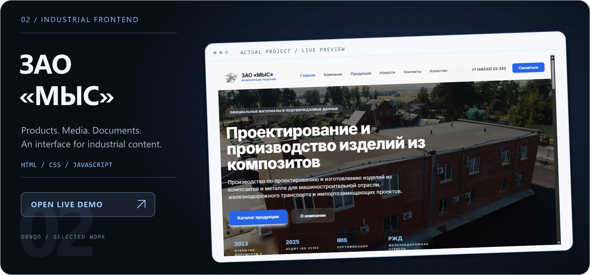
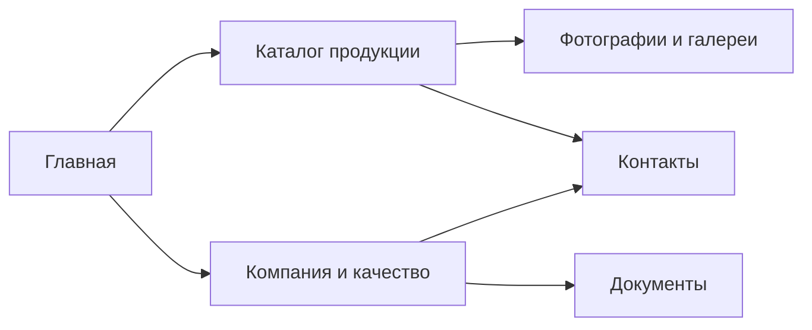

[← Профиль](https://github.com/obnqo40) · [Все проекты](projects.md) · [Все демо](demos.md)

# ЗАО «МЫС»

**Многостраничный промышленный сайт: от знакомства с предприятием до просмотра продукции и документов.**

[Открыть демо ↗](https://obnqo40.github.io/zao_mys/) · [Исходный код](https://github.com/obnqo40/zao_mys) · [Запуск локально](https://github.com/obnqo40/zao_mys#запуск)

## Задача

Организовать насыщенный промышленный контент так, чтобы посетитель мог быстро понять направления работы, найти продукцию, изучить документы и перейти к контакту.

## Как устроен путь пользователя

## Реализация

- **Страницы по задачам.** Каталог, компания, качество, новости и контакты имеют отдельные адреса.
- **Общий слой оформления.** `assets/site.css` и `assets/site.js` объединяют стили и браузерные сценарии между страницами.
- **Галереи.** Alpine.js управляет состоянием lightbox, переходами между изображениями и клавиатурными действиями.
- **Движение с учётом настроек.** Общие анимации учитывают `prefers-reduced-motion`; эффекты наведения включаются для точного указателя.
- **Работа с изображениями.** Для изображений задаётся асинхронное декодирование, часть материалов загружается отложенно.
- **Контактный сценарий.** Форма проверяет поля и подготавливает черновик письма через `mailto:`.

## Что открыть

| Посетителю | Разработчику |
| :--- | :--- |
| [Каталог и галереи](https://obnqo40.github.io/zao_mys/products.html) | [`products.html`](https://github.com/obnqo40/zao_mys/blob/main/products.html) |
| [Главная и навигация](https://obnqo40.github.io/zao_mys/) | [`index.html`](https://github.com/obnqo40/zao_mys/blob/main/index.html) |
| [Контактная форма](https://obnqo40.github.io/zao_mys/contacts.html) | [`assets/site.js`](https://github.com/obnqo40/zao_mys/blob/main/assets/site.js) |
| [Качество и документы](https://obnqo40.github.io/zao_mys/quality.html) | [`quality.html`](https://github.com/obnqo40/zao_mys/blob/main/quality.html) |

## Границы проекта

Это frontend-реализация. Серверная отправка обращений, CRM и хранение заявок в ней не реализованы. Для части стилей, библиотек и шрифтов используются внешние CDN. Размещение демо на GitHub Pages не означает официальный статус сайта предприятия.

**Стек:** HTML, CSS, JavaScript, Tailwind CSS, Alpine.js, Lucide.
